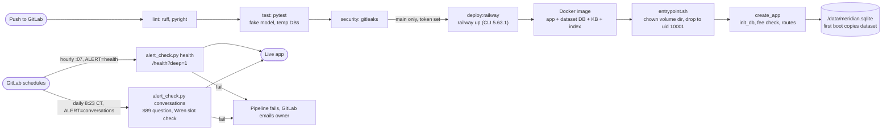

# Build, deploy and alerts

_Last updated: 2026-10-20 — new: GitLab CI, the Railway deploy, startup, and the alert schedules._

**Notes.**
- CI runs on the owner's ARM Mac runner (Docker executor). Scheduled pipelines run only the alert jobs; the deploy job never runs on a schedule.
- `scripts/live_checks.sh` is run by hand after a deploy: headers, `/health`, docs routes off, and a fake `X-Forwarded-For` ignored. It makes no model calls.
