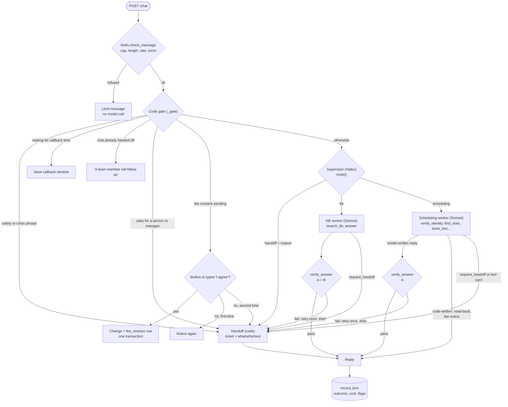

# One caller message

_Last updated: 2026-10-20 — new: the order a message goes through, from limits to the recorded turn._

**Notes.**
- The gate checks safety and crisis before anything else, even in a closed chat. A model failure (after one retry and the backup) or a crash also ends in the handoff box.
- Scheduling replies get check A only. KB answers get A and B. Code-written texts aren't checked.
- Booking happens only inside `book_slot` when `confirm.agreed_option` matches one offered option; otherwise code sends "Just to confirm: …?".
