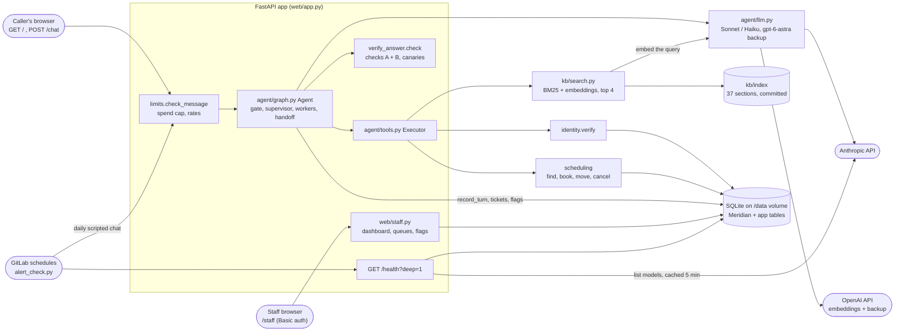

# System overview

_Last updated: 2026-10-20 — rewritten for the built system: chat, agent graph, model adapter, hybrid search, scheduling, staff pages, monitoring, alerts and evals._

One FastAPI process on Railway serves the chat page and the staff pages. The agent runs inside it. SQLite on the Railway volume holds Meridian's tables and ours. Model providers are reached only through `agent/llm.py`.

## Legend

- **Seams.** The model adapter (`agent/llm.py`) is the only module that sends chats or embeddings; tests swap in a fake. Search is a function the agent receives (`Search`), so tests use deterministic fake vectors. All business dates come from `clock.today()`. The one exception is the `/health?deep=1` provider check, which calls the Anthropic SDK from `web/app.py`.
- **Writes.** Only `scheduling`, `db`, `monitoring`, `feedback` and `limits` write to the DB. Every account tool takes the customer from the verified session.
- **Offline, not drawn:** `kb/convert.py` and `kb/build_index.py` build `kb/converted/` and `kb/index/`. `discovery/` labels the 420 transcripts. `evals/` runs the agent in-process against temp DB copies.
- Message order: [`message-flow.md`](message-flow.md). Build and deploy: [`deploy.md`](deploy.md).
